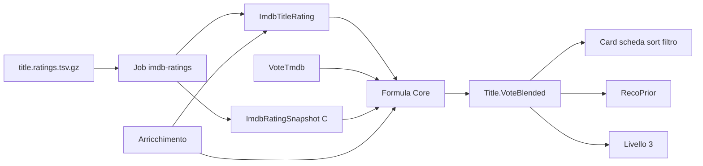

# ANALYSIS — voti-imdb

> Generato da: agente di pianificazione
> Data assessment: 2026-11-26
> Branch: `main`

Documento di riferimento tecnico. Non riscrivere le sezioni precedenti. Le scoperte successive vanno in §7.

---

## 1. Contesto e perimetro

### 1.1 Obiettivo

Aggiungere un job settimanale che scarica `https://datasets.imdbws.com/title.ratings.tsv.gz`, estrae il TSV e lo carica in una tabella indicizzata per `tconst` (`Title.ImdbId`). Allineare quei voti ai titoli già in catalogo, conservarli in colonne distinte dal voto TMDB e persistere una media pesata. Quel valore è il voto del titolo in card, scheda, ordinamento, filtro voto minimo, prior di For you e feature di voto del livello 3.

Richiesta originale dell'utente, 2026-11-26: dataset IMDb settimanale; match su `tconst`; colonna IMDb separata dal TMDB; media pesata per numero di voti con la formula weighted rating `(v/(v+m))·R + (m/(v+m))·C`; una sola fonte usa il voto disponibile e non una media con zero; scale già 0–10; salvare i due voti e i due conteggi, non solo la media.

Risposte del gate, stessa data:

| Tema | Scelta |
| --- | --- |
| Dominio | `voti-imdb` |
| Due fonti | Shrink bayesiano su ciascuna fonte, poi media delle due curve pesata per `w = v/(v+m)` |
| Una fonte | Voto grezzo, senza shrink e senza indicatore di pochi voti |
| Parametri | `m = 500`, `C` = media del dump IMDb pesata per i voti, costanti di codice |
| Superfici | Card, scheda (con il dettaglio delle due fonti), ordinamento, filtro, prior di For you e feature di livello 3 |
| Freschezza | Job settimanale su tutto il catalogo; l'arricchimento copia dalla tabella locale quando ha `ImdbId` |
| Orario | Domenica 04:00, ora del server, più trigger manuale |
| Livello 3 | Voto calcolato al posto del TMDB grezzo; feature aggiuntiva sul numero di voti; riallineare training e inferenza se la formula cambia o se `C` varia in modo sensibile |

Scelte delegate all'agente e registrate in STATUS.md §4: feature di conteggio = somma dei voti utilizzabili normalizzata con `log10(1+v)/6` (D-011); soglia «sensibile» = `0,05` punti su `C` (D-006); fonte senza conteggio positivo (D-009); backfill iniziale dal TMDB (D-010).

| Requisito | Criterio verificabile | Task | Fonte |
| --- | --- | --- | --- |
| R-01 | Un import riuscito sostituisce la tabella `tconst` e salva `C`, conteggio righe e istante. Header TSV assente o zero righe valide: tabella precedente intatta | T03, T05 | richiesta utente; D-007 |
| R-02 | Ogni titolo con `ImdbId` presente nel dump ha `VoteImdb` e `VoteImdbCount`. Un `tconst` sparito dal dump azzera quelle colonne. `VoteTmdb` e `VoteTmdbCount` restano quelli di TMDB | T04, T06 | richiesta utente |
| R-03 | `VoteBlended` è il risultato della formula di §6.2 con `m = 500` e la `C` dello snapshot | T01, T04, T06 | D-002 |
| R-04 | Una sola fonte produce il grezzo. Nessun testo UI di «pochi voti» | T01, T08 | D-003 |
| R-05 | Card e numero principale della scheda mostrano `VoteBlended` a un decimale. La scheda elenca IMDb e TMDB con i conteggi, quando presenti | T07, T08 | D-004 |
| R-06 | `sort=rating` e `minRating` usano `VoteBlended`. Un nullo non supera il filtro | T07 | D-004 |
| R-07 | `RecoPrior` usa `VoteBlended` senza shrink aggiuntivo. Senza voto, il componente bayesiano è la media del pool. Pesi 0,7 / 0,3 invariati | T09 | D-005 |
| R-08 | Il vettore di livello 3 ha il voto calcolato e la feature di conteggio di V-05. Un import con prima `C` o con `\|ΔC\| ≥ 0,05` accoda un `RecoBuild` | T05, T10 | D-006, D-011 |
| R-09 | L'arricchimento ricalcola il blend dalla tabella locale, senza nuova GET al dataset | T06 | D-007 |
| R-10 | Eccezione di rete, gzip non valido o parse rifiutato: nessuna scrittura su snapshot, tabella e titoli | T03 | D-007 |
| R-11 | La migrazione aggiunge colonne e tabelle e copia `VoteTmdb` in `VoteBlended` dove il TMDB c'è. Nessun drop | T02 | D-010 |
| R-12 | D-03, spec tecnica, `recommendations.md` e guida utente descrivono dataset, formula, job e voto mostrato | T05, T07, T08, T10, T11 | D-012 |
| R-13 | Il job è registrato `0 4 * * 0` in ora locale ed è lanciabile da Impostazioni → Job | T05 | D-008 |

Fuori perimetro: prior di household, embedding, profilo sparso, esplorazione, chiavi di impostazione per `m` e `C`, indicatore visivo dei pochi voti, OMDb.

### 1.2 Fonti analizzate

- `src/Pickarr.Core/Domain/Entities/Title.cs`
- `src/Pickarr.Core/Catalog/TitleQueryModels.cs`
- `src/Pickarr.Core/Recommendations/RecoPrior.cs`
- `src/Pickarr.Core/Recommendations/RecoLevel3.cs`
- `src/Pickarr.Infrastructure/Metadata/EnrichmentService.cs` (`ApplyDetails`)
- `src/Pickarr.Infrastructure/Metadata/Reco/RecoLevel3Model.cs`
- `src/Pickarr.Infrastructure/Metadata/Reco/RecoLevel3Training.cs`
- `src/Pickarr.Infrastructure/Catalog/TitleQueryService.cs`
- `src/Pickarr.Infrastructure/Catalog/RecoBuildService.cs`
- `src/Pickarr.Infrastructure/Jobs/ScheduleReconciler.cs`
- `src/Pickarr.Infrastructure/Jobs/MetadataRefreshJob.cs`
- `src/Pickarr.Infrastructure/Admin/AdminJobService.cs`
- `src/Pickarr.Infrastructure/Persistence/PickArrDbContext.cs`
- `src/Pickarr.Infrastructure/Persistence/Configurations/TitleConfiguration.cs`
- `src/Pickarr.Core/Domain/SyncRunKinds.cs`
- `src/Pickarr.WebApp/src/features/catalog/TitleCard.tsx`
- `src/Pickarr.WebApp/src/features/title/TitleDialog.tsx`
- `src/Pickarr.WebApp/src/api/types.ts`
- `docs/functional-spec.md` §11.3 D-03
- `docs/recommendations.md` §12.2
- `docs/technical-spec.md` (job, DTO `ratingTmdb` / `ratings.tmdb`)
- Test: `RecoPriorTests.cs`, `RecoLevel3ModelTests.cs`, `ScheduleReconcilerTests.cs`, `RecoEvalMetricsTests.cs`, `RecoTemporalRankingTests.cs`

### 1.3 Stato as-is

`Title` ha `VoteTmdb`, `VoteTmdbCount`, `Popularity`, `ImdbId` (indicizzato, formato `tt…` uguale a `tconst`). Non ha voto IMDb né voto calcolato. L'arricchimento TMDB scrive i due campi TMDB e, se presente, `ImdbId`.

La card mostra `ratingTmdb`. La scheda mostra la riga «TMDB» senza conteggio. `TitleQueryService` filtra e ordina `sort=rating` su `VoteTmdb`. Il DTO dettaglio è `TitleRatingsDto(Tmdb, TmdbVotes)`.

`RecoPrior.Compute` applica già uno shrink con `m = 300` e `C` = media non pesata dei `VoteTmdb` del pool, poi `0,7 · bayes normalizzato + 0,3 · popolarità`. Il livello 3 si addestra in memoria a ogni build (`RecoLevel3Model.TryTrain`); il modello non è salvato su disco. La feature voto è `VoteTmdb / 10` (assente → 0,5). `RecoLevel3TrainingTitle` porta `VoteTmdb`.

I job ricorrenti si registrano in `ScheduleReconciler`. Il trigger manuale passa da `AdminJobService.TriggerAsync` e dalla pagina Job. D-03 in `docs/functional-spec.md` dice di non integrare il voto IMDb e di mostrare solo TMDB. Questa KB sostituisce quella decisione con il dataset pubblico, non con OMDb.

---

## 2. Componenti principali

| Componente | Ruolo | File | Accoppiamento |
| --- | --- | --- | --- |
| `Title` | Anagrafica e voti TMDB | `src/Pickarr.Core/Domain/Entities/Title.cs` | alto |
| `TitleConfiguration` | Indici, tra cui `ImdbId` | `Persistence/Configurations/TitleConfiguration.cs` | medio |
| `EnrichmentService.ApplyDetails` | Scrive voto TMDB e `ImdbId` | `Metadata/EnrichmentService.cs` | alto |
| `TitleQueryService` | Filtro, sort, DTO lista e dettaglio | `Catalog/TitleQueryService.cs` | alto |
| `RecoPrior` / `RecoTitleStats` | Prior di livello 0 | `Core/Recommendations/RecoPrior.cs` | alto |
| `RecoLevel3.BuildFeatures` | Vettore del classificatore | `Core/Recommendations/RecoLevel3.cs` | alto |
| `RecoLevel3Training` | Esempi cross-fit | `Metadata/Reco/RecoLevel3Training.cs` | medio |
| `RecoBuildService` | Prior, training, score | `Catalog/RecoBuildService.cs` | alto |
| `RecoEvalService` | Stesso carico voti della build | `Catalog/RecoEvalService.cs` | medio |
| `ScheduleReconciler` | Cron dei job | `Jobs/ScheduleReconciler.cs` | medio |
| `AdminJobService` | Elenco e trigger | `Admin/AdminJobService.cs` | medio |
| `TitleCard` / `TitleDialog` | Voto visibile | `WebApp/.../TitleCard.tsx`, `TitleDialog.tsx` | medio |

---

## 3. Flussi individuati

### FLUSSO-01 — Import dataset IMDb

- **Trigger**: cron domenicale e `POST /api/v1/admin/jobs/imdb-ratings/trigger`. Oggi assente.
- **File sorgente**: da creare accanto a `Jobs/MetadataRefreshJob.cs` e `Admin/AdminJobService.cs`.
- **Sequenza attesa**:
  1. GET del gzip fuori da transazioni sul catalogo.
  2. Parse completo. Header inatteso o zero righe valide: stop, database invariato.
  3. In una transazione: sostituzione della tabella `tconst`, scrittura di `C` e metadati.
  4. Ricalcolo di `VoteImdb`, `VoteImdbCount` e `VoteBlended` sui titoli.
  5. Se è il primo snapshot o `|ΔC| ≥ 0,05`, enqueue di `RecoBuildJob`.
- **Dipendenze**: rete verso `datasets.imdbws.com`, SQLite del catalogo, Hangfire.
- **Rischi**: la sostituzione di circa un milione di righe tiene un lock di scrittura. Orario domenica 04:00. Parse fuori dal lock.
- **Test esistenti**: nessuno sul dataset. Modello di job: `MetadataRefreshJob`, `ScheduleReconcilerTests`.

### FLUSSO-02 — Arricchimento TMDB

- **Trigger**: `EnrichmentJob` orario e refresh metadati.
- **File sorgente**: `EnrichmentService.ApplyDetails`.
- **Sequenza as-is**: scrive `VoteTmdb`, `VoteTmdbCount`, `ImdbId`, poi immagini e generi.
- **Sequenza attesa**: subito dopo, lookup locale per `ImdbId` e ricalcolo del blend. Nessuna GET IMDb.
- **Test esistenti**: `tests/Pickarr.Infrastructure.Tests/EnrichmentServiceTests.cs`.

### FLUSSO-03 — Lettura catalogo

- **Trigger**: elenco titoli e dettaglio.
- **File sorgente**: `TitleQueryService` (filtro circa riga 157, DTO dettaglio circa riga 498, lista circa riga 650, sort circa riga 869).
- **As-is**: `VoteTmdb` per filtro, badge e sort.
- **Atteso**: `VoteBlended` per filtro, sort e numero mostrato. Il dettaglio espone anche i due grezzi e i conteggi.
- **Test esistenti**: `TitleQueryServiceTests`, test API di catalogo se coprono `minRating` o `sort=rating`.

### FLUSSO-04 — Prior e livello 3

- **Trigger**: `RecoBuildJob`, eval.
- **File sorgente**: `RecoPrior.cs`, `RecoBuildService.cs` (carico stats circa riga 240, `BuildFeatures` circa riga 308), `RecoEvalService.cs`, `RecoLevel3Training.cs`.
- **As-is**: shrink TMDB `m = 300`; feature voto = TMDB grezzo.
- **Atteso**: componente voto = `VoteBlended` grezzo rispetto al prior; feature voto = blend/10; nuova feature di conteggio in coda, senza rinumerare gli indici esistenti.
- **Test esistenti**: `RecoPriorTests.cs`, `RecoLevel3ModelTests.cs`, `RecoEvalMetricsTests.cs`, `RecoTemporalRankingTests.cs`.

### FLUSSO-05 — UI voto

- **Trigger**: render card e scheda.
- **File sorgente**: `TitleCard.tsx` (badge su `ratingTmdb`), `TitleDialog.tsx` (riga TMDB), `api/types.ts`, `en.json` chiave `title.ratingTmdb`.
- **Atteso**: badge e numero principale sul voto calcolato; in scheda le due fonti con i conteggi.
- **Test esistenti**: `TitleCard` e `TitleDialog.rating.test.tsx` costruiscono `ratingTmdb` e `ratings.tmdb`.

---

## 4. Dipendenze e vincoli tecnici

| Dipendenza | Tipo | Vincolo | Impatto |
| --- | --- | --- | --- |
| Dataset IMDb | servizio | V-01, V-07, V-08 | Download solo nel job settimanale o manuale |
| SQLite catalogo | infra | V-09 | Migrazione additiva; lock lungo solo a import riuscito e già parsato |
| Hangfire | lib | V-07 | Stesso schema di `ScheduleReconciler` e `AdminJobService` |
| EF Core | lib | V-09 | `dotnet ef` con startup `Pickarr.Api`; snapshot generato, non scritto a mano |
| Livello 3 ML.NET | lib | V-05, V-06 | `VectorType(RecoLevel3.FeatureCount)` segue la costante |
| Docs | prodotto | V-10 | Inglese nei file sotto `docs/` e in `en.json` |
| CONV-04 della KB comune | processo | conflitto noto | Percorsi `backend/` e `frontend/` obsoleti; comandi nel addendum §5 |

---

## 5. Problematiche e tech debt rilevati

| ID | Gravità | Descrizione | Impatto se non risolto |
| --- | --- | --- | --- |
| A-001 | Bassa | `docs/functional-spec.md` dichiara lingua inglese; la tabella §11.3, inclusa D-03, è ancora in italiano | Aggiornare la riga D-03 in inglese, senza tradurre il resto della tabella |
| A-002 | Bassa | `_skill_memory/planning/AGENT_KB.md` CONV-04 cita cartelle assenti | Seguire l'addendum di questo dominio |
| A-003 | Media | Senza backfill, il primo avvio con card su `VoteBlended` nasconderebbe i voti TMDB già presenti fino al job | T02 copia `VoteTmdb` in `VoteBlended` |

Nessun finding di gravità alta. Lo stato aperto durante l'esecuzione sta in STATUS.md §3.

---

## 6. Architettura target (to-be)

### 6.1 Principi

- Formula pura in Core, senza I/O.
- Dump completo in tabella propria, così un titolo nuovo si allinea senza un altro download.
- Le colonne grezze restano anche dopo un cambio di formula.
- Il voto mostrato e il prior leggono la stessa colonna `VoteBlended`.
- L'import è sostituibile per intero e si interrompe prima di scrivere se il file non è un dump valido.

### 6.2 Formula

`m = 500`. `C = Σ(R·v) / Σ(v)` sulle righe valide del dump.

Una fonte è pesabile se `R` non è nullo e `v > 0`.

```
w = v / (v + m)
WR = w·R + (1 − w)·C
```

- Due fonti pesabili: `VoteBlended = (w_i·WR_i + w_t·WR_t) / (w_i + w_t)`.
- Una sola fonte pesabile: `VoteBlended = R` di quella fonte.
- Nessuna fonte pesabile e un solo `R` non nullo: `VoteBlended = R`.
- Nessun `R`, oppure due `R` e nessuna fonte pesabile: `VoteBlended = null`.

`v` della feature di livello 3 è la somma dei conteggi delle fonti pesabili. Non è `w`.

Esempi con `C = 7` da fissare nei test:

- IMDb 8,0 con 500 voti e TMDB 6,0 con 500 voti → `w = 0,5`, `WR` 7,5 e 6,5, risultato 7,0.
- Solo IMDb 9,1 con 12 voti → 9,1.
- Solo TMDB 7,4 con 80 voti → 7,4.
- IMDb 9,0 con 0 voti e TMDB 8,0 con 100 voti → 8,0.
- Nessun voto → null.

### 6.3 Persistenza

- `ImdbTitleRating`: PK `Tconst` (`tt` + cifre, lunghezza massima 16), `AverageRating`, `NumVotes`. La PK è l'indice richiesto.
- `ImdbRatingSnapshot`: una riga, `MeanVote` (`C`), `RowCount`, `ImportedAt`, URL sorgente.
- `Title`: `VoteImdb` (`double?`), `VoteImdbCount` (`int?`), `VoteBlended` (`double?`). Indice su `VoteBlended` per sort e filtro.
- Backfill nella migrazione: `VoteBlended = VoteTmdb` dove `VoteTmdb` non è nullo.

### 6.4 Job e lettura

- Id ricorrente `imdb-ratings`, kind `ImdbRatings`, cron `0 4 * * 0`, `TimeZoneInfo.Local`.
- Gli altri cron restano come sono.
- Lista: nuovo campo `ratingScore` = `VoteBlended`. `ratingTmdb` resta il grezzo TMDB.
- Dettaglio: `ratings.score`, `ratings.imdb`, `ratings.imdbVotes`, `ratings.tmdb`, `ratings.tmdbVotes`.
- `RecoTitleStats` per il prior porta `VoteBlended` al posto della coppia TMDB. Il livello 3 riceve blend e conteggio utilizzabile da un record di training aggiornato.

### 6.5 Alternative scartate

| Alternativa | Motivo |
| --- | --- |
| Solo media pesata per i voti, senza shrink | Scartata al gate: shrink per fonte, poi media per confidenza |
| Shrink anche sull'unica fonte | Scartata al gate |
| `m = 25000` o `m = 300`, `C` locale TMDB | Scartata al gate |
| Solo UI, prior ancora su TMDB | Scartata al gate |
| Secondo shrink del prior sopra `VoteBlended` | Scartato al gate: doppio shrink sulle due fonti |
| Feature di confidenza `v/(v+m)` al posto del conteggio | Scartata in delega (D-011): il conteggio ha una sola definizione per una o due fonti; `m` è già dentro il voto calcolato |
| Solo job settimanale, senza lookup in arricchimento | Scartata al gate |
| OMDb o altro provider | D-03 si aggiorna verso il dataset ufficiale, non verso OMDb |
| Chiavi di impostazione per `m` e `C` | I grezzi restano salvati; la formula si cambia nel codice |



---

## 7. Scoperte post-assessment

| Data | Sezione | Scoperta | Impatto |
| --- | --- | --- | --- |
| 2026-11-26 | §3 FLUSSO-01 | Un `tconst` ripetuto nello stesso file tiene l'ultima riga valida. Un file con header giusto ma somma voti zero è rifiutato come privo di righe utilizzabili e non sostituisce il dump. | Nessun cambio di acceptance. K-007 resta un'ipotesi sul file reale. |

---

## 8. Fatti e ipotesi riusabili

| ID | Tipo | Informazione | Fonte e versione | Rivalidare quando |
| --- | --- | --- | --- | --- |
| K-001 | FACT | `Title.VoteTmdb` e `VoteTmdbCount` sono i soli voti di pubblico. `ImdbId` è indicizzato | `Title.cs`, `TitleConfiguration.cs`; HEAD `e759d3c9aabee2a451fdb912088634eed180c0f0` | Cambio di quelle proprietà |
| K-002 | FACT | Card, dettaglio, `minRating` e `sort=rating` leggono `VoteTmdb` | `TitleCard.tsx`, `TitleDialog.tsx`, `TitleQueryService.cs`; stesso HEAD | Dopo T07/T08 |
| K-003 | FACT | `RecoPrior` shrinka `VoteTmdb` con `VoteDamping = 300` e media non pesata del pool | `RecoPrior.cs`; stesso HEAD | Dopo T09 |
| K-004 | FACT | `RecoLevel3Model.TryTrain` crea il modello in memoria nel build. Non c'è salvataggio del modello | `RecoLevel3Model.cs`; stesso HEAD | Se il modello diventa persistito |
| K-005 | FACT | `BuildFeatures` mette il voto all'indice `HashBuckets + 9` e la popolarità a `+ 10`. `FeatureCount = HashBuckets + 11` | `RecoLevel3.cs`; stesso HEAD | Dopo T10 |
| K-006 | FACT | D-03 vieta il voto IMDb in UI e cita OMDb come strada non presa | `docs/functional-spec.md` §11.3; stesso HEAD | Dopo T11 |
| K-007 | HYPOTHESIS | Il TSV ha header `tconst`, `averageRating`, `numVotes` e l'ordine di grandezza è 1–2 milioni di righe | Dataset pubblico citato dall'utente; file non scaricato in questa sessione | Primo parse: rifiutare header diverso; `RowCount` sullo snapshot |
| K-008 | DECISION | Formula, superfici, orario, prior e feature di conteggio | STATUS.md §4 D-002 … D-013; approvazione gate 2026-11-26 | Nuova decisione in §4 |
